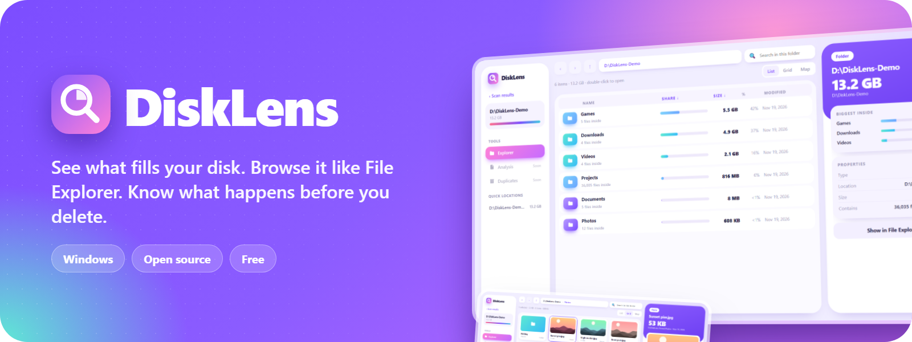
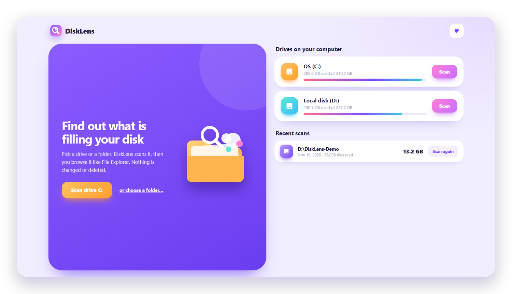
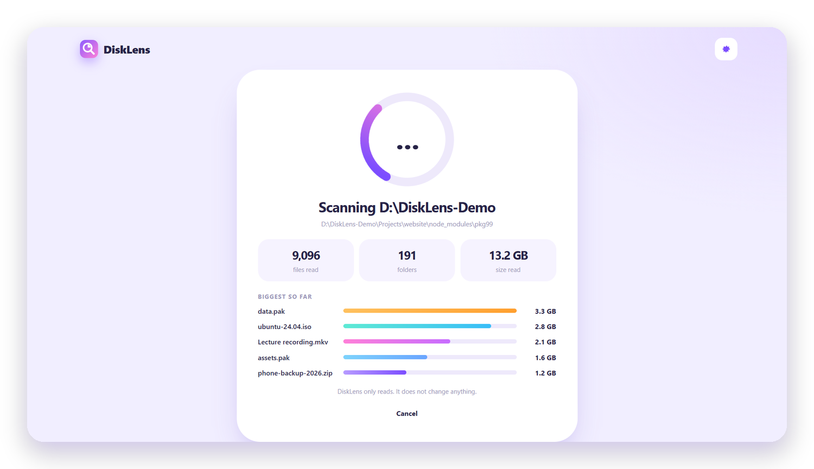
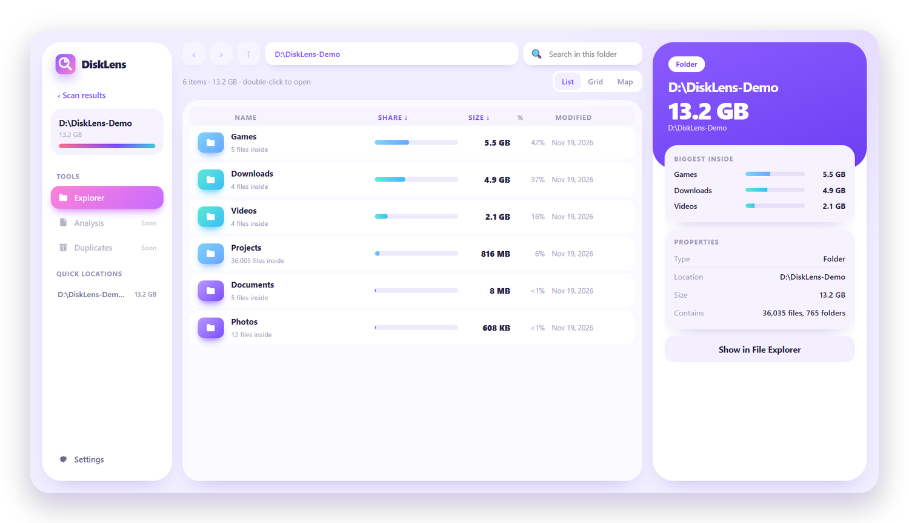
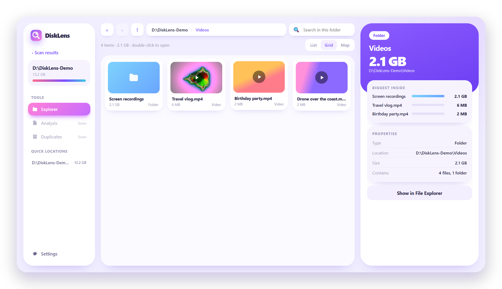
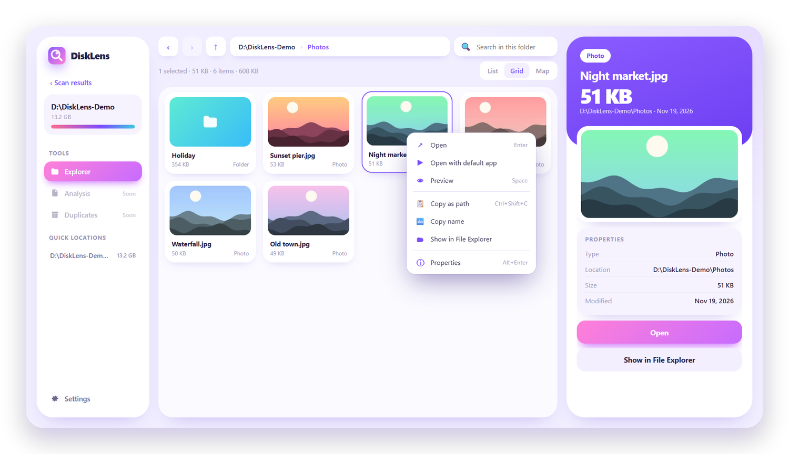
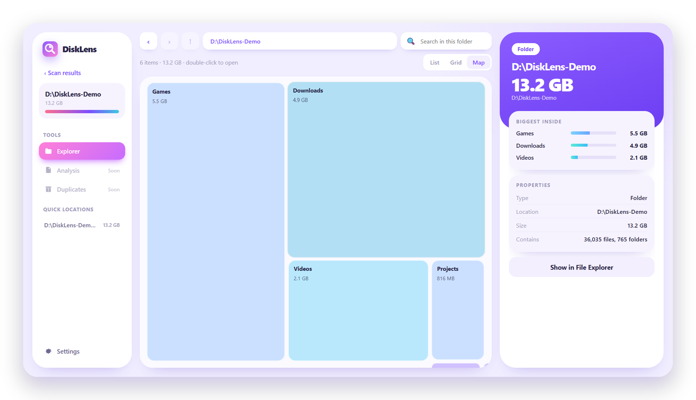
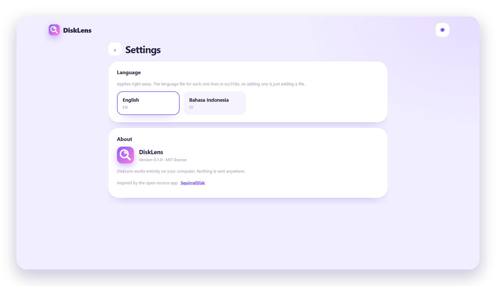

<p align="center">
  
</p>

<p align="center">
  <a href="README.md">English</a> · <b>Bahasa Indonesia</b>
</p>

<p align="center">
  
  
  
  
</p>

DiskLens menunjukkan folder dan file mana yang paling banyak memakan ruang, dan kamu bisa menelusurinya seperti di File Explorer. Yang terbesar ada di atas, setiap folder menampilkan seberapa besar porsinya, dan foto serta video punya thumbnail asli.

Tujuan besarnya: menjelaskan setiap item sebelum kamu menghapusnya, yaitu apa itu dan apa yang rusak kalau dihapus. Bagian itu sedang dikerjakan (lihat [Selanjutnya](#selanjutnya)). Versi 0.1 hanya membaca disk dan tidak pernah mengubah atau menghapus apa pun.

---

## Cara kerjanya

### 1. Pilih drive atau folder

Semua drive di komputermu tampil beserta seberapa penuh isinya. Scan satu drive utuh, atau pilih satu folder saja.

<p align="center"></p>

### 2. Lihat proses scan

Angka terus naik selama DiskLens membaca, dan file terbesar yang ditemukan langsung muncul. Link dan junction dilewati supaya tidak ada yang terhitung dua kali, dan file dengan beberapa hard link (banyak di `Windows\WinSxS`) dihitung sekali.

<p align="center"></p>

### 3. Lihat hasilnya

Berapa banyak isi drive berupa video, foto, arsip, program, dan lainnya, plus sisa ruang kosong di drive.

<p align="center"></p>

### 4. Jelajahi seperti File Explorer

Tombol mundur, maju, dan naik, alamat yang bisa diklik, cari di dalam folder, urutkan menurut nama, ukuran, atau tanggal. Setiap baris menampilkan porsinya di folder itu, jadi yang paling berat langsung terlihat.

<p align="center"></p>

<table>
  <tr>
    <td width="50%"><p align="center"><b>Grid dengan thumbnail asli</b><br>Diambil dari Windows, sama dengan yang tampil di File Explorer.</p></td>
    <td width="50%"><p align="center"><b>Video juga</b><br>Cuplikan video sebagai thumbnail, siap dipratinjau.</p></td>
  </tr>
  <tr>
    <td width="50%"><p align="center"><b>Menu klik kanan</b><br>Buka, buka dengan aplikasi bawaan, pratinjau, salin path, tampilkan di File Explorer, properti.</p></td>
    <td width="50%"><p align="center"><b>Pratinjau</b><br>Klik dua kali foto atau video. Tombol panah pindah ke file berikutnya.</p></td>
  </tr>
  <tr>
    <td width="50%"><p align="center"><b>Peta ukuran</b><br>Setiap item jadi kotak seukuran ruang yang dipakainya.</p></td>
    <td width="50%"><p align="center"><b>Bahasamu</b><br>Saat ini Inggris dan Indonesia. Menambah bahasa cukup menambah satu file.</p></td>
  </tr>
</table>

### Pintasan keyboard

| Tombol | Fungsi |
|---|---|
| `Enter` / klik dua kali | Buka folder, pratinjau foto atau video, buka file lain |
| `Spasi` | Pratinjau foto atau video yang dipilih |
| `Backspace`, `Alt` + `↑` | Naik satu folder |
| `Alt` + `←` / `→` | Mundur / maju |
| `↑` `↓`, `Shift` + `↑` `↓` | Pindah atau perluas pilihan |
| `Ctrl` + klik, `Shift` + klik, `Ctrl` + `A` | Pilih banyak item |
| `Ctrl` + `Shift` + `C` | Salin path yang dipilih |
| `Alt` + `Enter` | Properti |
| `F5` | Segarkan folder |
| `Esc` | Tutup menu atau pratinjau, batalkan pilihan |

---

## Selanjutnya

- [x] Scan asli, hanya membaca
- [x] Penjelajah: daftar, grid, peta ukuran, thumbnail, pratinjau, klik kanan, properti
- [x] Bahasa: Inggris, Indonesia
- [ ] **Analisis**: penjelasan singkat "Apa ini?" dan "Kalau dihapus?" untuk setiap item, dikelompokkan jadi aman, cek dulu, dan jangan dihapus
- [ ] **Keranjang kumpul**: seret item ke keranjang, periksa, lalu pindahkan ke Recycle Bin, pindahkan ke drive lain, atau hapus permanen (dengan pilihan timpa 3x). Folder sistem tetap terkunci.
- [ ] **Duplikat**: temukan file kembar dan simpan satu saja
- [ ] **File lama**: file yang lama tidak dibuka
- [ ] Installer dan `.exe` portable di halaman [Releases](../../releases)
- [ ] Bahasa lain

## Privasi

DiskLens bekerja sepenuhnya di komputermu. Nama file, ukuran, atau apa pun tidak dikirim lewat internet, dan tidak ada telemetri.

## Menjalankan dari kode sumber

Butuh [Node.js](https://nodejs.org) versi 18 atau lebih baru.

```bash
git clone https://github.com/EEDTAN/DiskLens.git
cd DiskLens
npm install
npm start
```

## Menambah bahasa

1. Salin `src/i18n/en.json` menjadi file baru sesuai kode bahasa, misalnya `src/i18n/ja.json`.
2. Ganti `"_name"` dengan nama bahasa itu dalam bahasanya sendiri, misalnya `"日本語"`.
3. Terjemahkan nilainya. Kunci dan `{placeholder}` jangan diubah.
4. Kirim pull request. Bahasa baru langsung muncul di Pengaturan.

## Terinspirasi dari SquirrelDisk

Ide peta disk yang ramah dan bisa dipakai untuk bersih-bersih berasal dari [SquirrelDisk](https://github.com/adileo/squirreldisk) karya adileo, penganalisis disk gratis dan open source yang layak dicoba. DiskLens ditulis dari nol dengan desain sendiri, dan tidak berisi kode, gambar, atau teks dari SquirrelDisk.

## Lisensi

[MIT](LICENSE) © EEDTAN
