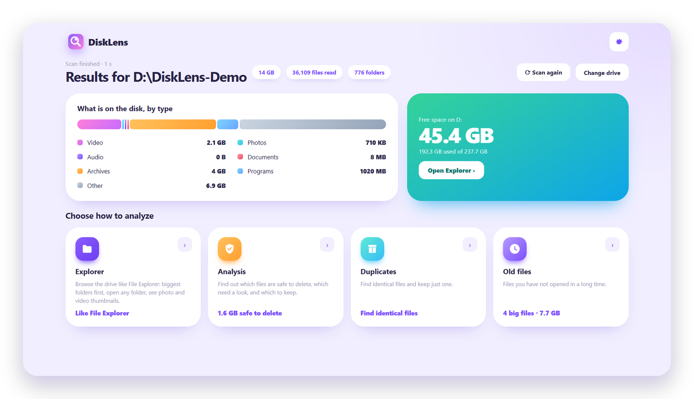
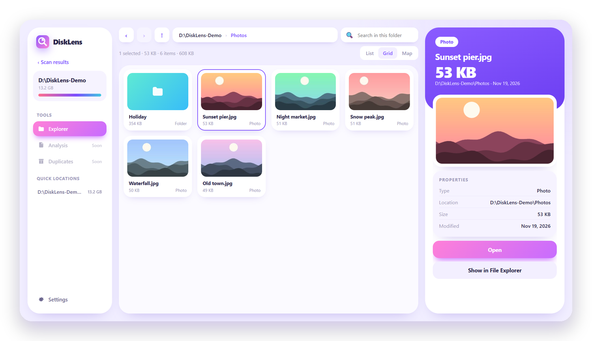
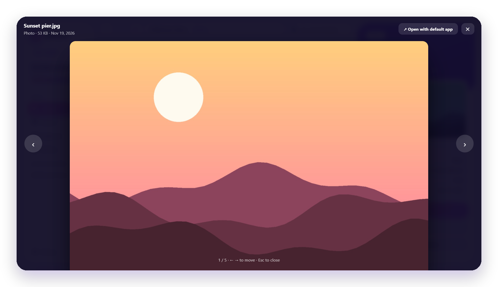
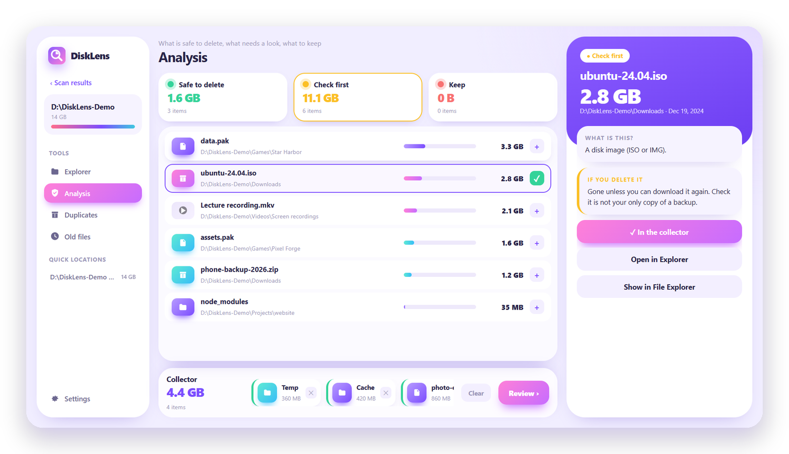
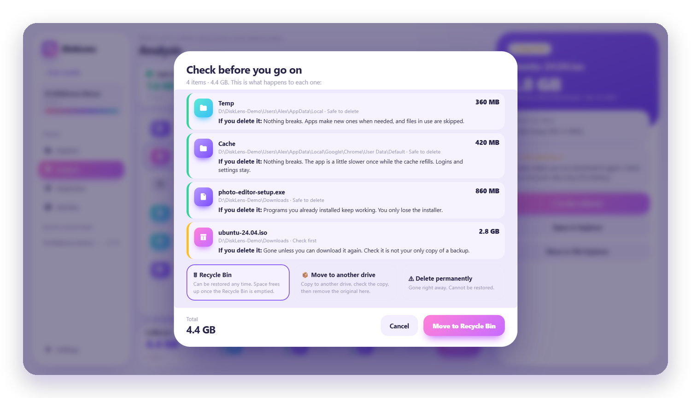
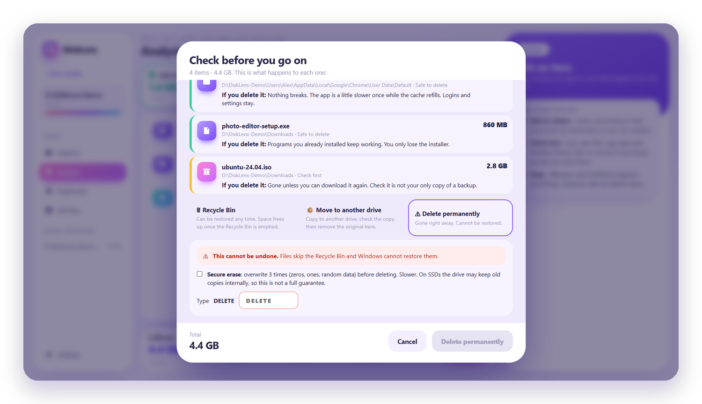
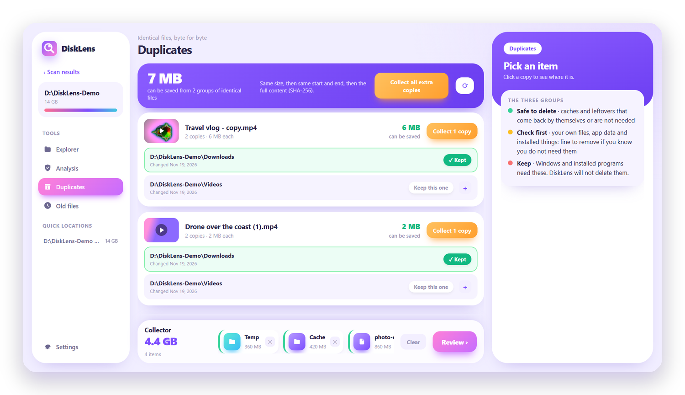
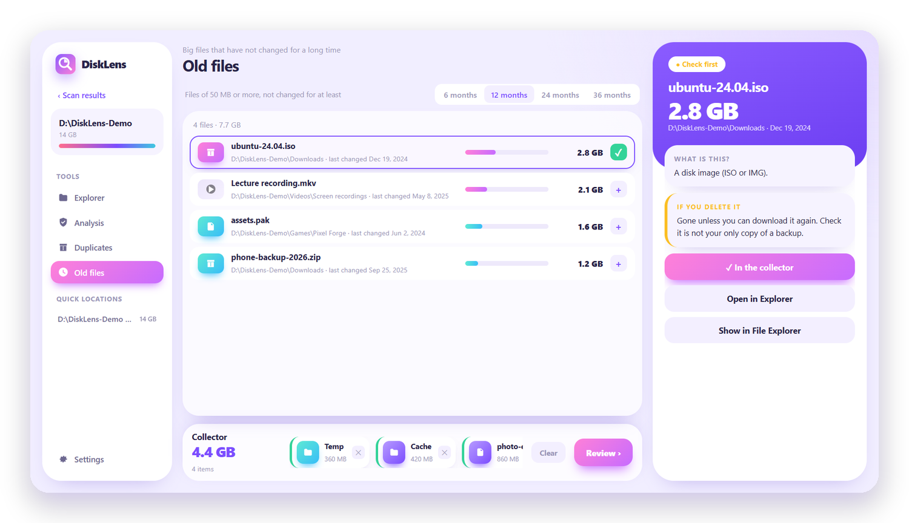

<p align="center">
  
</p>

<p align="center">
  <a href="README.md">English</a> · <b>Bahasa Indonesia</b>
</p>

<p align="center">
  <a href="https://github.com/EEDTAN/DiskLens/releases/latest"></a>
  
  
  
</p>

DiskLens menunjukkan folder dan file mana yang paling banyak memakan ruang, dan kamu bisa menelusurinya seperti di File Explorer. DiskLens juga menjelaskan apa setiap item itu dan apa yang rusak kalau dihapus. Kalau sudah siap, kumpulkan yang mau dibuang lalu bersihkan sekaligus: ke Recycle Bin, pindah ke drive lain, atau hapus permanen.

Kamu tidak perlu lagi bertanya ke orang lain (atau ke AI) apakah sebuah folder aman dihapus. DiskLens yang memberi tahu, dan DiskLens menolak menyentuh Windows serta program yang terpasang.

## Unduh

| | |
|---|---|
| **Installer** | [**DiskLens-Setup.exe**](https://github.com/EEDTAN/DiskLens/releases/latest/download/DiskLens-Setup.exe), menambah menu Start dan shortcut di desktop |
| **Portable** | [**DiskLens-Portable.exe**](https://github.com/EEDTAN/DiskLens/releases/latest/download/DiskLens-Portable.exe), tanpa instalasi, bisa dijalankan dari folder mana pun atau flashdisk |

Windows 10 dan 11, 64-bit. Semua versi ada di halaman [Releases](https://github.com/EEDTAN/DiskLens/releases).

**Pembaruan.** Mulai versi 0.3.0, app yang terpasang mengecek GitHub setiap dibuka. Kalau ada versi baru, muncul kartu kecil dengan tombol **Perbarui sekarang**; hasil unduhan dipasang saat kamu memilih **Mulai ulang dan pasang**, dan pengaturan serta riwayatmu tetap ada. Pengecekan bisa dimatikan atau dijalankan manual di **Pengaturan → Pembaruan**. Versi portable tidak bisa mengganti dirinya sendiri, jadi hanya memberi tahu ada versi baru dan membuka halaman unduhan. Masih memakai 0.2.x? Pasang 0.3.0 sekali secara manual; setelah itu app memperbarui dirinya sendiri.

<details>
<summary>Windows menampilkan "Windows protected your PC"</summary>

DiskLens belum ditandatangani secara digital (sertifikatnya berbayar), jadi SmartScreen memberi peringatan beberapa kali pertama. Klik **More info**, lalu **Run anyway**. Seluruh kode sumbernya ada di repo ini, dan installer-nya dibuat oleh GitHub Actions dari kode itu.
</details>

---

## Cara kerjanya

### 1. Pilih drive atau folder

Semua drive tampil beserta seberapa penuh isinya. Scan satu drive utuh, atau pilih satu folder.

<p align="center"></p>

### 2. Lihat proses scan

Angka terus naik selama DiskLens membaca, dan file terbesar langsung muncul begitu ditemukan. Link dan junction dilewati supaya tidak ada yang terhitung dua kali, dan file dengan beberapa hard link (banyak di `Windows\WinSxS`) dihitung sekali. Scan hanya membaca.

<p align="center"></p>

### 3. Lihat hasil dan pilih alat

Ruang per jenis file, sisa ruang kosong, dan empat cara melihat lebih dekat: **Penjelajah**, **Analisis**, **Duplikat**, dan **File lama**.

<p align="center"></p>

### 4. Penjelajah: seperti File Explorer

Tombol mundur, maju, dan naik, alamat yang bisa diklik, pencarian, urutan menurut nama, ukuran, atau tanggal. Setiap baris menampilkan porsinya di folder itu, jadi yang paling berat langsung terlihat.

<p align="center"></p>

<table>
  <tr>
    <td width="50%"><p align="center"><b>Thumbnail asli</b><br>Diambil dari Windows, sama dengan yang tampil di File Explorer.</p></td>
    <td width="50%"><p align="center"><b>Video juga</b><br>Cuplikan video sebagai thumbnail, siap dipratinjau.</p></td>
  </tr>
  <tr>
    <td width="50%"><p align="center"><b>Menu klik kanan</b><br>Buka, buka dengan aplikasi bawaan, pratinjau, tambah ke keranjang, analisis, salin path, properti.</p></td>
    <td width="50%"><p align="center"><b>Pratinjau</b><br>Klik dua kali foto atau video. Tombol panah pindah ke file berikutnya.</p></td>
  </tr>
</table>

<p align="center"><br><b>Peta ukuran</b>: setiap item jadi kotak seukuran ruang yang dipakainya.</p>

### 5. Analisis: mana yang aman dihapus

DiskLens mengenali cache, file sementara, installer, data crash, sisa Windows, folder game, cache developer, disk WSL, OneDrive, dan banyak lagi, lalu mengelompokkannya jadi tiga:

- **Aman dihapus**: cache dan sisa file yang dibuat ulang sendiri atau tidak diperlukan
- **Cek dulu**: file milikmu, data aplikasi, dan program terpasang
- **Jangan dihapus**: Windows dan program terpasang. DiskLens tidak akan menghapusnya.

Klik satu item untuk membaca **Apa ini?**, **Kalau dihapus**, dan sering juga **Cara yang lebih baik** (misalnya pakai Disk Cleanup untuk `WinSxS`, atau copot program lewat Pengaturan, bukan menghapus foldernya).

<table>
  <tr>
    <td width="50%"></td>
    <td width="50%"></td>
  </tr>
</table>

### 6. Kumpulkan dulu, bersihkan sekaligus

Seret baris ke keranjang di bawah, tekan **+**, pilih beberapa item lalu **Tambah semua ke keranjang**, atau tekan **Kumpulkan semua** di Analisis dan File lama. Setelah selesai, tekan **Periksa**. Setiap item ditampilkan lagi beserta akibatnya kalau dihapus, dan data aplikasi meminta konfirmasi tambahan.

<p align="center"></p>

<table>
  <tr>
    <td width="33%"><p align="center"><b>Recycle Bin</b><br>Bisa dikembalikan kapan saja.</p></td>
    <td width="33%"><p align="center"><b>Pindah ke drive lain</b><br>Disalin, setiap file diperiksa dengan SHA-256, lalu yang asli dihapus.</p></td>
    <td width="33%"><p align="center"><b>Hapus permanen</b><br>Ketik kata konfirmasi. Ada pilihan timpa 3x.</p></td>
  </tr>
</table>

### 7. Duplikat

Mencari file yang isinya sama persis: ukuran sama, lalu awal dan akhir sama, lalu seluruh isi (SHA-256). Hard link dari satu file tidak dianggap duplikat. Pilih salinan mana yang disimpan, kumpulkan sisanya.

<p align="center"></p>

### 8. File lama

File besar (50 MB ke atas) yang tidak berubah selama 6, 12, 24, atau 36 bulan.

<p align="center"></p>

---

## Keamanan

- Scan, Penjelajah, Analisis, Duplikat, dan File lama hanya membaca disk.
- Tidak ada yang dihapus sampai kamu menekan tombol terakhir di jendela pemeriksaan.
- DiskLens menolak menghapus atau memindahkan akar drive, `Windows`, `Program Files`, `ProgramData`, `Users`, folder profilmu dan folder utamanya, folder Recycle Bin, file boot, `pagefile.sys`, serta DiskLens sendiri. Penolakan ini terjadi di main process, bukan hanya di tampilan.
- Pemindahan menyalin dulu, memeriksa salinannya, baru menghapus yang asli. Kalau pemeriksaan gagal, yang asli tetap ada.
- Setiap pembersihan tercatat di **Pengaturan → Riwayat pembersihan**.

## Pintasan keyboard

| Tombol | Fungsi |
|---|---|
| `Enter` / klik dua kali | Buka folder, pratinjau foto atau video, buka file lain |
| `Spasi` | Pratinjau foto atau video yang dipilih |
| `Delete` | Periksa pilihan dengan **Recycle Bin** terpilih |
| `Shift` + `Delete` | Periksa pilihan dengan **Hapus permanen** terpilih |
| `Backspace`, `Alt` + `↑` | Naik satu folder |
| `Alt` + `←` / `→` | Mundur / maju |
| `↑` `↓`, `Shift` + `↑` `↓` | Pindah atau perluas pilihan |
| `Ctrl` + klik, `Shift` + klik | Pilih banyak item |
| `Ctrl` + `A` atau tombol **Pilih semua** | Pilih semua isi folder, tekan lagi untuk membatalkan |
| `Ctrl` + `Shift` + `C` | Salin path yang dipilih |
| `Alt` + `Enter` | Properti |
| `F5` | Segarkan folder |
| `Esc` | Tutup menu, pratinjau, atau jendela, batalkan pilihan |

## Bahasa

Inggris dan Indonesia, bisa diganti di **Pengaturan**. Saat pertama dibuka, DiskLens mengikuti bahasa Windows.

<p align="center"></p>

### Menambah bahasa

1. Salin `src/i18n/en.json` menjadi file baru sesuai kode bahasa, misalnya `src/i18n/ja.json`.
2. Ganti `"_name"` dengan nama bahasa itu dalam bahasanya sendiri, misalnya `"日本語"`.
3. Terjemahkan nilainya. Kunci, `{placeholder}`, dan tag `<b>` jangan diubah.
4. Kirim pull request. Bahasa baru langsung muncul di Pengaturan.

## Privasi

DiskLens bekerja sepenuhnya di komputermu. Nama file, ukuran, atau apa pun tidak dikirim lewat internet, dan tidak ada telemetri.

## Build sendiri

Butuh [Node.js](https://nodejs.org) versi 18 atau lebih baru.

```bash
git clone https://github.com/EEDTAN/DiskLens.git
cd DiskLens
npm install
npm start          # jalankan app
npm run dist       # buat dist/DiskLens-Setup.exe dan dist/DiskLens-Portable.exe
```

Push tag seperti `v0.2.0` akan membuat kedua file lewat GitHub Actions dan melampirkannya ke sebuah rilis.

## Terinspirasi dari SquirrelDisk

Ide peta disk yang ramah dan bisa dipakai untuk bersih-bersih berasal dari [SquirrelDisk](https://github.com/adileo/squirreldisk) karya adileo, penganalisis disk gratis dan open source yang layak dicoba. DiskLens ditulis dari nol dengan desain dan fitur sendiri, dan tidak berisi kode, gambar, atau teks dari SquirrelDisk.

## Lisensi

[MIT](LICENSE) © EEDTAN
