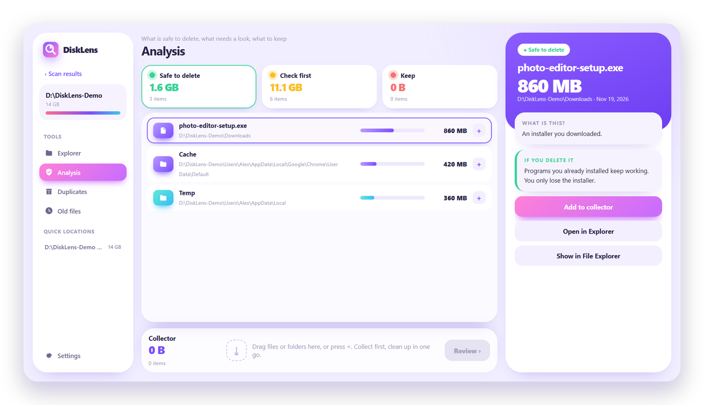
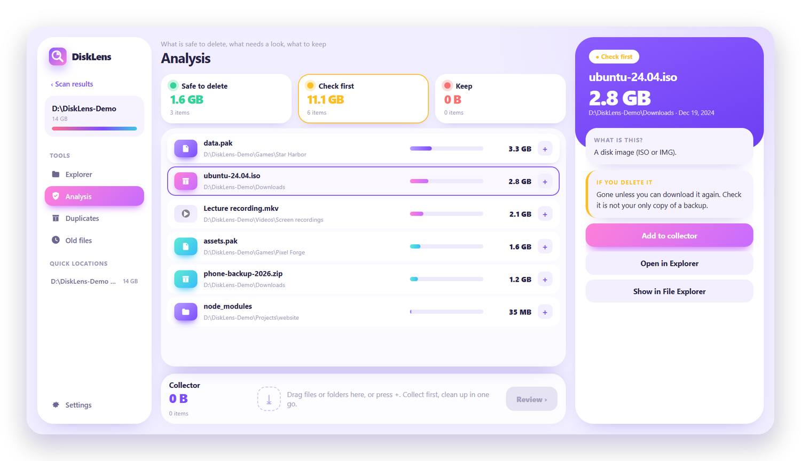
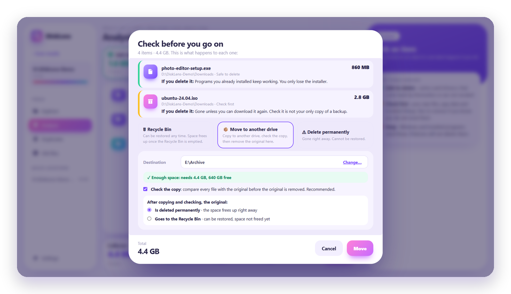

<p align="center">
  
</p>

<p align="center">
  <b>English</b> · <a href="README.id.md">Bahasa Indonesia</a>
</p>

<p align="center">
  <a href="https://github.com/EEDTAN/DiskLens/releases/latest"></a>
  
  
  
</p>

DiskLens shows you which folders and files take up the most space, lets you walk through them the way you already know from File Explorer, and tells you what each thing is and what breaks if you delete it. When you are ready, you collect what you want gone and clean it up in one go: Recycle Bin, move to another drive, or delete permanently.

You should not need to ask anyone (or any AI) whether a folder is safe to remove. DiskLens tells you, and it refuses to touch Windows and installed programs.

## Download

| | |
|---|---|
| **Installer** | [**DiskLens-Setup.exe**](https://github.com/EEDTAN/DiskLens/releases/latest/download/DiskLens-Setup.exe), adds a Start menu entry and a desktop shortcut |
| **Portable** | [**DiskLens-Portable.exe**](https://github.com/EEDTAN/DiskLens/releases/latest/download/DiskLens-Portable.exe), no installation, runs from any folder or USB stick |

Windows 10 and 11, 64-bit. All versions are on the [Releases](https://github.com/EEDTAN/DiskLens/releases) page.

**Updates.** From version 0.3.0 the installed app checks GitHub for a new version when it starts. When one is out, a small card offers **Update now**; the download installs when you choose **Restart and install**, and your settings and history stay. You can turn the check off or run it yourself in **Settings → Updates**. The portable version cannot replace itself, so it only tells you a new version exists and opens the download page. Coming from 0.2.x? Install 0.3.0 once by hand; after that it updates itself.

<details>
<summary>Windows says "Windows protected your PC"</summary>

DiskLens is not code-signed yet (a certificate costs money), so SmartScreen warns about it the first few times. Click **More info**, then **Run anyway**. The full source code is in this repository, and the installers are built by GitHub Actions from it.
</details>

---

## How it works

### 1. Pick a drive or a folder

Every drive is listed with how full it is. Scan a whole drive, or choose one folder.

<p align="center"></p>

### 2. Watch the scan

Counters climb while DiskLens reads, and the biggest files show up as soon as they are found. Links and junctions are skipped so nothing is counted twice, and a file with several hard links (common in `Windows\WinSxS`) counts once. The scan only reads.

<p align="center"></p>

### 3. See the results and pick a tool

Space by file type, free space left, and four ways to look closer: **Explorer**, **Analysis**, **Duplicates** and **Old files**.

<p align="center"></p>

### 4. Explorer: browse it like File Explorer

Back, forward and up, a clickable address bar, search, sorting by name, size or date. Each row shows its share of the folder, so the heavy ones stand out.

<p align="center"></p>

<table>
  <tr>
    <td width="50%"><p align="center"><b>Real thumbnails</b><br>Pulled from Windows, the same ones File Explorer shows.</p></td>
    <td width="50%"><p align="center"><b>Videos too</b><br>Frames as thumbnails, ready to preview.</p></td>
  </tr>
  <tr>
    <td width="50%"><p align="center"><b>Right-click menu</b><br>Open, open with the default app, preview, add to the collector, analyze, copy path, properties.</p></td>
    <td width="50%"><p align="center"><b>Preview</b><br>Double-click a photo or video. Arrow keys move to the next one.</p></td>
  </tr>
</table>

<p align="center"><br><b>Size map</b>: every item as a block sized by the space it takes.</p>

### 5. Analysis: what is safe to delete

DiskLens recognizes caches, temp files, installers, crash dumps, Windows leftovers, game folders, developer caches, WSL disks, OneDrive and much more, then sorts them into three groups:

- **Safe to delete**: caches and leftovers that come back by themselves or are not needed
- **Check first**: your own files, app data and installed things
- **Keep**: Windows and installed programs. DiskLens will not delete these.

Click an item to read **What is this?**, **If you delete it**, and often a **Better way** (for example, use Disk Cleanup for `WinSxS`, or uninstall a program in Settings instead of deleting its folder).

<table>
  <tr>
    <td width="50%"></td>
    <td width="50%"></td>
  </tr>
</table>

### 6. Collect first, clean up in one go

Drag rows into the collector at the bottom, press **+**, select several items and use **Add all to collector**, or press **Collect all** in Analysis and Old files. When you are done, press **Review**. Every item is listed again with what happens if it is deleted, and app data asks for an extra confirmation.

<p align="center"></p>

<table>
  <tr>
    <td width="33%"><p align="center"><b>Recycle Bin</b><br>Can be restored any time.</p></td>
    <td width="33%"><p align="center"><b>Move to another drive</b><br>Copies, checks every file with SHA-256, then removes the original.</p></td>
    <td width="33%"><p align="center"><b>Delete permanently</b><br>Type the confirmation word. Optional 3-pass overwrite.</p></td>
  </tr>
</table>

### 7. Duplicates

Finds files with identical content: same size, then the same start and end, then the full SHA-256. Hard links of one file are not counted as duplicates. Pick which copy to keep, collect the rest.

<p align="center"></p>

### 8. Old files

Big files (50 MB or more) that have not changed in 6, 12, 24 or 36 months.

<p align="center"></p>

---

## Safety

- The scan, Explorer, Analysis, Duplicates and Old files only read your disk.
- Nothing is deleted until you press the final button in the review window.
- DiskLens refuses, in the main process and not just in the interface, to delete or move drive roots, `Windows`, `Program Files`, `ProgramData`, `Users`, your profile folder and its main folders, the Recycle Bin folder, boot files, `pagefile.sys` and DiskLens itself.
- Moving copies first, checks the copy, and only then removes the original. If the check fails, the original stays.
- Every clean-up is listed in **Settings → Clean-up history**.

## Keyboard

| Keys | Action |
|---|---|
| `Enter` / double-click | Open a folder, preview a photo or video, open any other file |
| `Space` | Preview the selected photo or video |
| `Delete` | Review the selection with **Recycle Bin** chosen |
| `Shift` + `Delete` | Review the selection with **Delete permanently** chosen |
| `Backspace`, `Alt` + `↑` | Up one folder |
| `Alt` + `←` / `→` | Back / forward |
| `↑` `↓`, `Shift` + `↑` `↓` | Move or extend the selection |
| `Ctrl` + click, `Shift` + click | Select several items |
| `Ctrl` + `A` or the **Select all** button | Select everything in the folder, press again to clear |
| `Ctrl` + `Shift` + `C` | Copy the selected paths |
| `Alt` + `Enter` | Properties |
| `F5` | Refresh the folder |
| `Esc` | Close a menu, preview or window, clear the selection |

## Languages

English and Bahasa Indonesia, switchable in **Settings**. DiskLens follows the Windows language the first time it starts.

<p align="center"></p>

### Add a language

1. Copy `src/i18n/en.json` to a new file named after the language code, for example `src/i18n/ja.json`.
2. Change `"_name"` to the language's own name, for example `"日本語"`.
3. Translate the values. Keep the keys, the `{placeholders}` and the `<b>` tags as they are.
4. Open a pull request. The language shows up in Settings by itself.

## Privacy

DiskLens runs entirely on your computer. It does not send file names, sizes or anything else over the internet, and it has no telemetry.

## Build it yourself

You need [Node.js](https://nodejs.org) 18 or newer.

```bash
git clone https://github.com/EEDTAN/DiskLens.git
cd DiskLens
npm install
npm start          # run the app
npm run dist       # build dist/DiskLens-Setup.exe and dist/DiskLens-Portable.exe
```

Pushing a tag such as `v0.2.0` builds both files with GitHub Actions and attaches them to a release.

## Inspired by SquirrelDisk

The idea of a friendly disk map you can clean up from comes from [SquirrelDisk](https://github.com/adileo/squirreldisk) by adileo, a free and open-source disk analyzer that is well worth a look. DiskLens is written from scratch with its own design and features. It does not contain SquirrelDisk's code, artwork or text.

## License

[MIT](LICENSE) © EEDTAN
