<p align="center">
  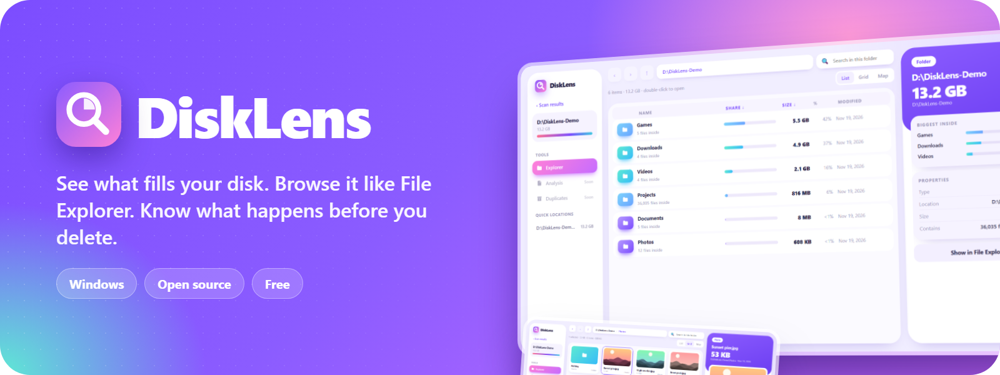
</p>

<p align="center">
  <b>English</b> · <a href="README.id.md">Bahasa Indonesia</a>
</p>

<p align="center">
  
  
  
  
</p>

DiskLens shows you which folders and files take up the most space, and lets you walk through them the way you already know from File Explorer. The biggest things sit at the top, every folder shows how much of its parent it fills, and photos and videos come with real thumbnails.

The bigger goal is to explain each item before you delete it: what it is, and what breaks if it goes. That part is being built now (see [What's next](#whats-next)). Version 0.1 only reads your disk. It never changes or deletes anything.

---

## How it works

### 1. Pick a drive or a folder

Every drive on your PC is listed with how full it is. Scan a whole drive, or pick one folder.

<p align="center">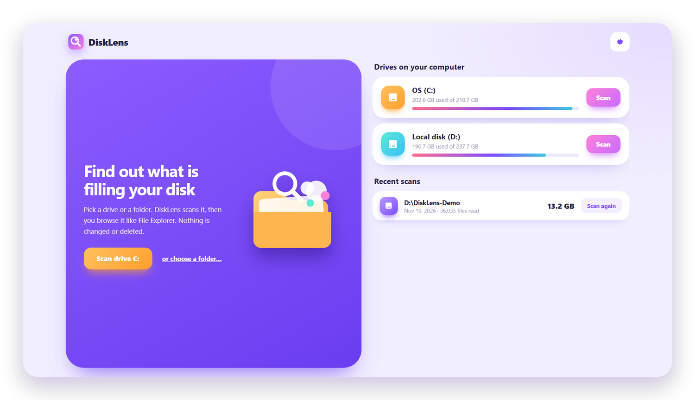</p>

### 2. Watch the scan

The counters climb while DiskLens reads, and the biggest files found so far appear right away. Links and junctions are skipped so nothing is counted twice, and a file with several hard links (common in `Windows\WinSxS`) counts once.

<p align="center">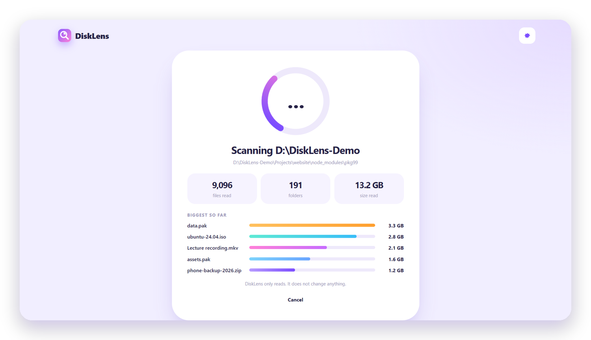</p>

### 3. See the results

How much is video, photos, archives, programs and the rest, plus how much free space the drive has left.

<p align="center">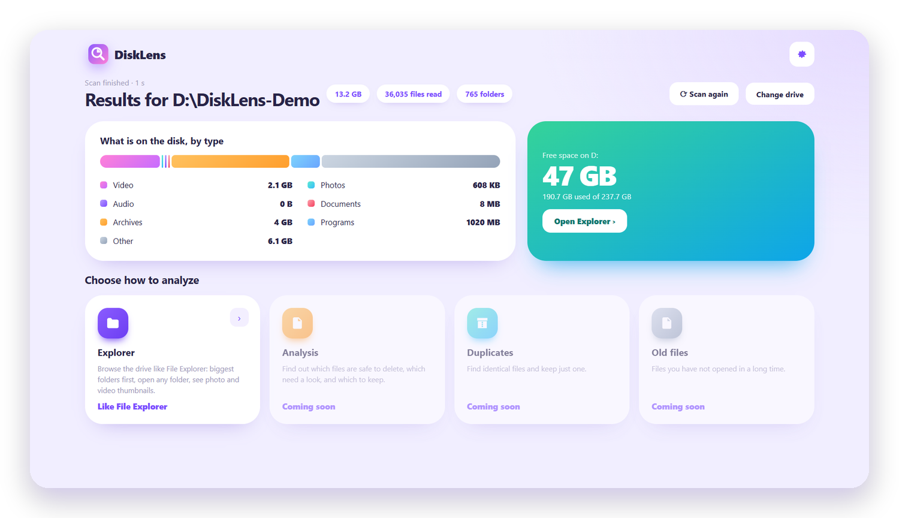</p>

### 4. Browse it like File Explorer

Back, forward and up buttons, a clickable address bar, search inside the folder, sorting by name, size or date. Each row shows its share of the folder, so the heavy ones are easy to spot.

<p align="center">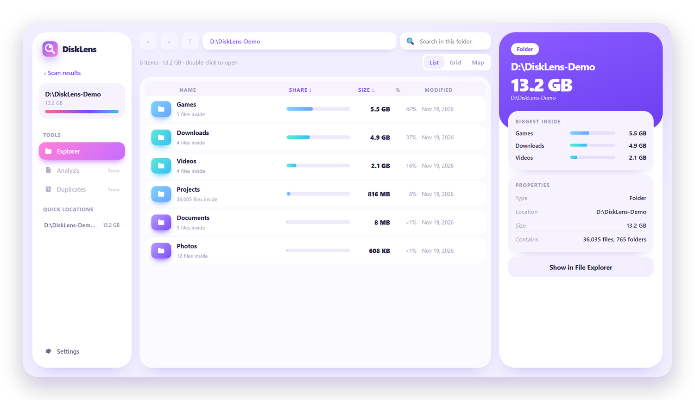</p>

<table>
  <tr>
    <td width="50%">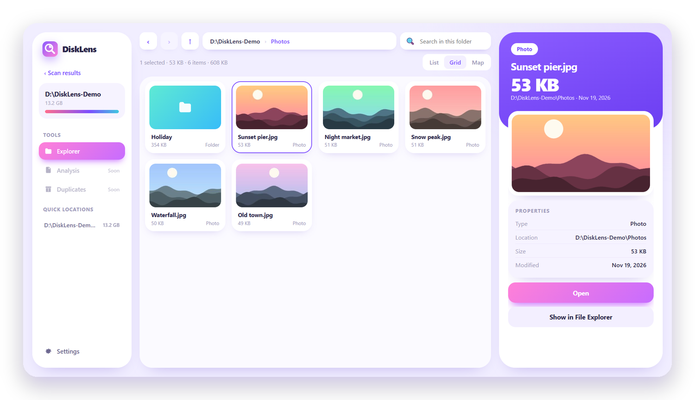<p align="center"><b>Grid with real thumbnails</b><br>Pulled from Windows, the same ones File Explorer shows.</p></td>
    <td width="50%">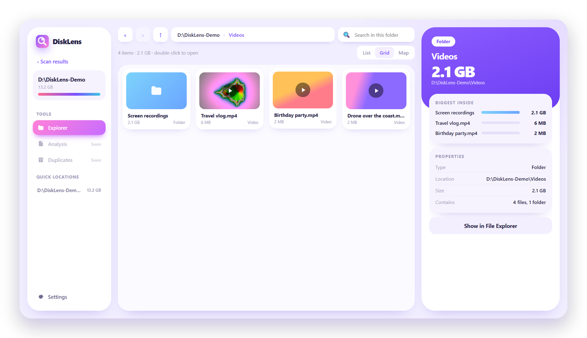<p align="center"><b>Videos too</b><br>Video frames as thumbnails, ready to preview.</p></td>
  </tr>
  <tr>
    <td width="50%">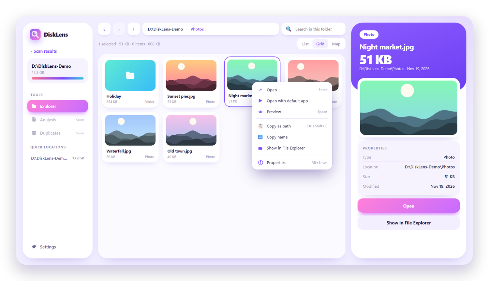<p align="center"><b>Right-click menu</b><br>Open, open with the default app, preview, copy path, show in File Explorer, properties.</p></td>
    <td width="50%">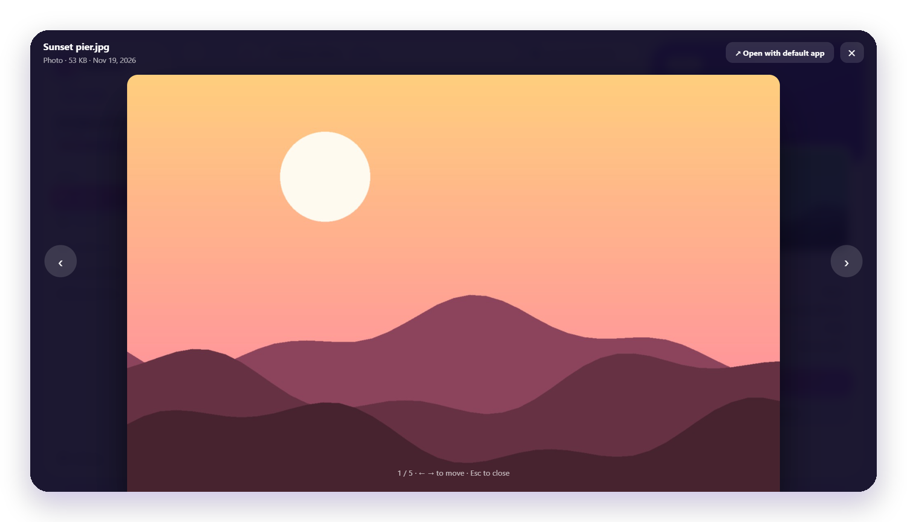<p align="center"><b>Preview</b><br>Double-click a photo or video. Arrow keys move to the next one.</p></td>
  </tr>
  <tr>
    <td width="50%">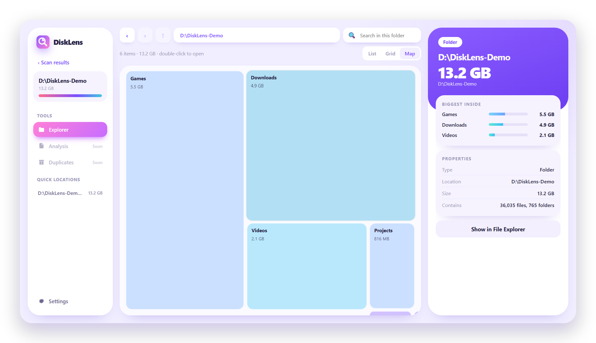<p align="center"><b>Size map</b><br>Every item as a block sized by how much space it takes.</p></td>
    <td width="50%">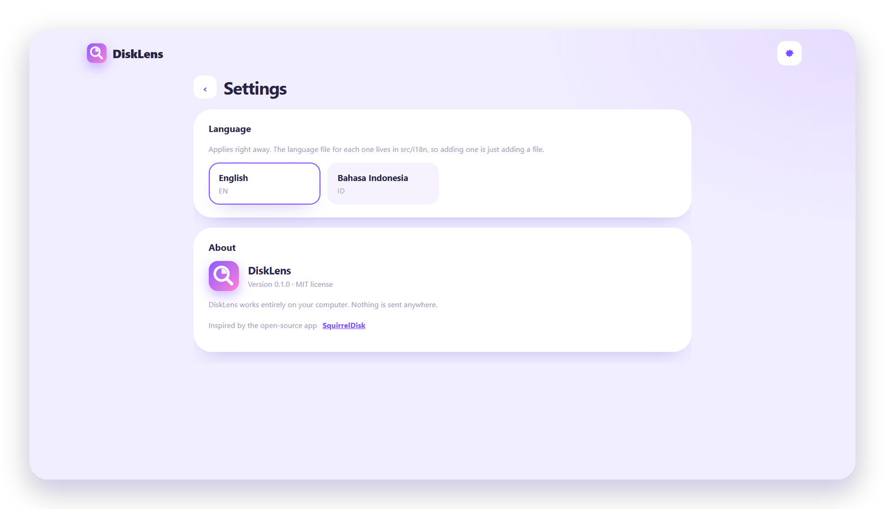<p align="center"><b>Your language</b><br>English and Bahasa Indonesia today. Adding one is adding one file.</p></td>
  </tr>
</table>

### Keyboard

| Keys | Action |
|---|---|
| `Enter` / double-click | Open a folder, preview a photo or video, open any other file |
| `Space` | Preview the selected photo or video |
| `Backspace`, `Alt` + `↑` | Up one folder |
| `Alt` + `←` / `→` | Back / forward |
| `↑` `↓`, `Shift` + `↑` `↓` | Move or extend the selection |
| `Ctrl` + click, `Shift` + click, `Ctrl` + `A` | Select several items |
| `Ctrl` + `Shift` + `C` | Copy the selected paths |
| `Alt` + `Enter` | Properties |
| `F5` | Refresh the folder |
| `Esc` | Close a menu or preview, clear the selection |

---

## What's next

- [x] Real scan, read-only
- [x] Explorer: list, grid, size map, thumbnails, preview, right-click menu, properties
- [x] Languages: English, Bahasa Indonesia
- [ ] **Analysis**: a short "What is this?" and "What happens if I delete it?" for each item, sorted into safe, check first, and keep
- [ ] **Collector**: drag items into a basket, review them, then move them to the Recycle Bin, move them to another drive, or delete permanently (with an optional 3-pass overwrite). System folders stay locked.
- [ ] **Duplicates**: find identical files and keep one copy
- [ ] **Old files**: things you have not opened in a long time
- [ ] Installer and portable `.exe` on the [Releases](../../releases) page
- [ ] More languages

## Privacy

DiskLens runs entirely on your computer. It does not send file names, sizes or anything else over the internet, and it has no telemetry.

## Run it from source

You need [Node.js](https://nodejs.org) 18 or newer.

```bash
git clone https://github.com/EEDTAN/DiskLens.git
cd DiskLens
npm install
npm start
```

## Add a language

1. Copy `src/i18n/en.json` to a new file named after the language code, for example `src/i18n/ja.json`.
2. Change `"_name"` to the language's own name, for example `"日本語"`.
3. Translate the values and keep the keys and the `{placeholders}` as they are.
4. Open a pull request. The new language shows up in Settings by itself.

## Inspired by SquirrelDisk

The idea of a friendly disk map you can clean up from comes from [SquirrelDisk](https://github.com/adileo/squirreldisk) by adileo, a free and open-source disk analyzer that is well worth a look. DiskLens is written from scratch with its own design. It does not contain SquirrelDisk's code, artwork or text.

## License

[MIT](LICENSE) © EEDTAN
